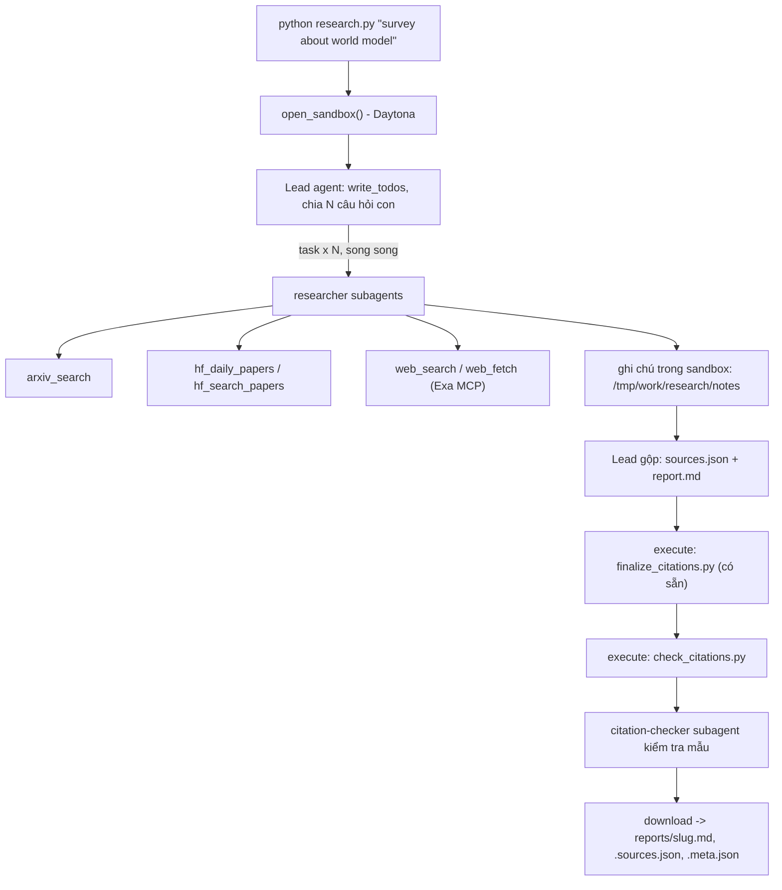

# Deep Research Agent (Deep Agents + Sandbox)

## Hướng dẫn chạy bản triển khai

Hệ thống lập kế hoạch, giao ít nhất ba researcher, tổng hợp bằng chứng và kiểm tra trích dẫn
trong sandbox. Công cụ mạng chạy trên host; khóa không được upload vào sandbox.

### Windows / PowerShell

```powershell
python -m venv .venv
& .\.venv\Scripts\python.exe -m pip install -r requirements.txt
Copy-Item .env.example .env  # chỉ khi chưa có .env
```

Điền `.env` cục bộ. Với Gemini dùng `LAB_MODEL=google_genai:<model-id>` và `GOOGLE_API_KEY`.
Với endpoint tương thích OpenAI dùng `LAB_BASE_URL`, `LAB_MODEL`, `LAB_API_KEY`.
Model phải hỗ trợ tool calling. Dùng `EXA_API_KEY` để giảm lỗi giới hạn tốc độ web.

Sandbox mặc định là Daytona (`DAYTONA_API_KEY`). Đặt `SANDBOX_FALLBACK=docker` để tự chuyển sang
Docker nếu tạo Daytona thất bại; hoặc `SANDBOX=docker` để dùng Docker ngay.
Docker Desktop phải đang chạy Linux containers; image cần Python 3 và bash.
Fallback không chạy lại khi agent thất bại, tránh nhân đôi lượt gọi mô hình.

```powershell
# Kiểm thử không gọi API / không tốn token
& .\.venv\Scripts\python.exe -m unittest discover -s tests -v

# Thử 5 công cụ với dữ liệu thật
& .\.venv\Scripts\python.exe tools.py

# Chạy một chủ đề
& .\.venv\Scripts\python.exe research.py "survey about world model"

# Sinh lại từ đầu sau khi nhận phản hồi kiểm chứng (không sửa đầu ra trên host)
& .\.venv\Scripts\python.exe research.py "survey about world model" --review-notes validation/world-model-review.md

# Rà và sửa báo cáo đã sinh: agent đọc bản cũ, nghiên cứu và sửa trong sandbox mới
& .\.venv\Scripts\python.exe research.py "survey about world model" --revise --review-notes validation/world-model-review.md

# Sửa lỗi cụ thể trên bản đã hợp lệ, giữ lịch sử nghiên cứu và kiểm chứng lại 5 khẳng định
& .\.venv\Scripts\python.exe research.py "survey about world model" --focused-revision --review-notes validation/world-model-review.md

# Chạy đủ 5 chủ đề; bỏ qua các kết quả đã qua kiểm tra khi tiếp tục
& .\.venv\Scripts\python.exe run_all.py --resume

# Kiểm tra trước khi nộp
& .\.venv\Scripts\python.exe self_check.py
```

### Đọc kết quả và kiểm tra

Mỗi chủ đề có ba file cùng basename trong `reports/`:

- `.md`: báo cáo tiếng Anh, tổng hợp theo chủ đề và References.
- `.sources.json`: nguồn được trích dẫn, gồm `n`, `id`, `url`, `title`, `date`, `source`.
- `.meta.json`: topic/model, thời gian, số lần giao việc, tool calls, token của lead, số nguồn và họ nguồn.

Tên file được làm sạch, tối đa 60 ký tự; tên của chủ đề dài có thể bị cắt.
Token trong metadata **không gồm subagent**, nên không phải tổng chi phí của lần chạy.
Với `--revise`, metadata chỉ đo lượt sửa hiện tại; `revision_of_sha256` nhận diện báo cáo cũ.
Lượt sửa vẫn có ít nhất ba researcher, audit nguồn và validator; không sửa file báo cáo trên host.
Với `--focused-revision`, giữ thống kê thật của lần sinh gốc và cộng thống kê lượt sửa;
`runs` ghi riêng model, thời gian, lượt giao việc và token của từng lượt. Agent chỉ sửa lỗi cụ thể,
dùng citation-checker kiểm chứng năm khẳng định và chạy lại hai script trong sandbox.
Metadata chỉ ghi các lượt thành công tạo nên bản nộp; không cộng các lượt thất bại hoặc bị ngắt.
Chế độ này yêu cầu bản gốc có ít nhất ba lượt giao việc, trích dẫn hợp lệ và ba họ nguồn.
Mỗi báo cáo phải có ít nhất ba họ nguồn trong `arxiv`, `hf-daily`, `hf-search`, `web`.
Họ nguồn là công cụ phát hiện nguồn; `web_fetch` không đổi nhãn nguồn đã tìm được.
Các mẫu đối chiếu nguồn nằm trong [validation/citation-spot-checks.md](validation/citation-spot-checks.md).
[validation/artifact-sha256.json](validation/artifact-sha256.json) ghi hash của 15 file nộp.

Lead chạy finalizer và validator trong sandbox, sau đó citation-checker kiểm tra năm khẳng định.
Middleware chặn ghi file ngoài ba vị trí đầu ra/ghi chú và chỉ cho `execute` chạy hai script được cung cấp.
Trước khi chấp nhận kết quả, host đối chiếu nguyên bytes hai script để phát hiện mọi thay đổi trong sandbox.
Sau mọi sửa đổi, lead phải chạy lại finalizer và validator. Host chỉ kiểm tra lại và lưu nguyên bytes
tải về; không sửa báo cáo. Kết quả thiếu/rỗng, citation sai, thiếu họ nguồn hoặc thiếu delegation
bị từ chối. File được ghi qua staging và khôi phục kết quả cũ nếu gặp lỗi ghi.

Giới hạn: lead 150 model calls/300 tool calls; mỗi subagent 40/60; graph recursion 1000.
Postflight kiểm tra cả họ nguồn/URL, cấu trúc báo cáo và các tool bắt buộc; nếu chưa đạt,
cho lead tối đa hai lượt sửa trong cùng sandbox. Các lượt sửa giữ lịch sử thật và được tính vào metadata;
giới hạn agent áp dụng cho mỗi invocation, và tổng số invocation của lead tối đa ba.
`LAB_MODEL_RPM` mặc định 10, dùng chung model rate limiter để giảm burst từ các researcher.
Free tier vẫn có hạn mức token và ngày riêng; HTTP 429 từ model có thể khiến lần chạy thất bại.
Lỗi model tạm thời được thử tối đa ba lần cho mỗi bước, tôn trọng thời gian chờ trong thông báo Gemini.
Lỗi xác thực hoặc hết hạn mức ngày dừng ngay. Với khóa có giới hạn 5 RPM, đặt `LAB_MODEL_RPM=4`.
`run_all.py` dừng ở chủ đề lỗi; sửa nguyên nhân rồi chạy tiếp bằng `--resume`.

Validator kiểm tra cấu trúc citation, không chứng minh mọi khẳng định đúng.
Mở và đối chiếu ít nhất năm citation mỗi báo cáo trước khi nộp. Chỉ sửa mã/prompt và sinh lại nếu sai.
Không commit `.env`, không đưa khóa vào sandbox. Không sửa các file được cung cấp sẵn.

---

Lab dựng một **hệ thống deep research đa tác tử**: người dùng chỉ cần nhập một chủ đề (ví dụ `survey about world model`), hệ thống tự lập kế hoạch, giao việc cho nhiều subagent, tìm tài liệu trên arXiv, Hugging Face và web, rồi viết một **báo cáo có trích dẫn**.

Hình thức: **bài thực hành cá nhân**. Ngôn ngữ lập trình: Python 3.11 trở lên.

## 1. Mục tiêu học tập

Sau lab, bạn có thể:

1. Dựng agent bằng thư viện Deep Agents (LangChain): công cụ (tool), system prompt, subagent, backend.
2. Dùng **sandbox** (Daytona) làm không gian làm việc và nơi chạy mã cho agent; hiểu vì sao khóa API và công cụ mạng phải nằm ở phía host chứ không nằm trong sandbox.
3. Viết công cụ gọi API ngoài **chịu được giới hạn tốc độ** (retry, backoff, jitter, `Retry-After`).
4. Thiết kế quy trình đa tác tử: lead chia nhỏ câu hỏi, giao cho N researcher chạy song song, tổng hợp và kiểm tra trích dẫn.
5. Tạo báo cáo có thể kiểm chứng: mọi khẳng định có `[n]` trỏ tới một nguồn có thật.

## 2. Hệ thống làm gì



Nguồn dữ liệu:

| Nguồn | Dùng để |
|---|---|
| arXiv API `https://export.arxiv.org/api/query` | Tìm bài theo từ khóa, sắp theo ngày |
| Hugging Face Daily Papers `/api/daily_papers` | Bài đang "trending": upvotes, githubRepo, summary |
| Hugging Face papers search `/api/papers/search?q=` | Tìm bài theo chủ đề |
| Web qua Exa MCP (`web_search_exa`, `web_fetch_exa`) | Blog, survey, trang dự án, nội dung đầy đủ của một URL |

## 3. Cấu trúc thư mục

```
Lab/
├── README.md  GUIDE.md  RUBRIC.md  REPORT_TEMPLATE.md   tài liệu
├── topics.md                 5 chủ đề cần chạy
├── requirements.txt  .env.example  .gitignore
├── model.py                  CÓ SẴN - không sửa: tạo mô hình LLM từ biến môi trường
├── sandbox.py                CÓ SẴN - không sửa: sandbox Daytona (hoặc Docker), upload, download
├── self_check.py             CÓ SẴN - không sửa: tự kiểm tra trước khi nộp (python self_check.py)
├── finalize_citations.py     CÓ SẴN - không sửa: script chạy trong sandbox, tự sinh `## References` và đánh số lại trích dẫn
├── tools.py                  SINH VIÊN CÀI ĐẶT: retry + 5 công cụ nguồn dữ liệu
├── agents.py                 SINH VIÊN CÀI ĐẶT: prompt, subagent, lead agent
├── research.py               SINH VIÊN CÀI ĐẶT: script chính
├── check_citations.py        SINH VIÊN CÀI ĐẶT: kiểm tra trích dẫn, chạy TRONG sandbox
└── reports/                  báo cáo sinh ra (bạn commit vào repo nộp)
```

Trong bộ khung gốc, các tệp "SINH VIÊN CÀI ĐẶT" là pseudo-code với `NotImplementedError`.
Bản triển khai này đã hoàn thiện các hàm và prompt; `GUIDE.md` và `RUBRIC.md` giữ nguyên yêu cầu lab.

## 4. Cài đặt

```bash
python3 -m venv .venv && source .venv/bin/activate      # Python 3.11+
pip install -r requirements.txt
cp .env.example .env                                     # rồi điền khóa CỦA BẠN
```

Bạn cần ba loại khóa (điền vào `.env`, **không bao giờ commit** `.env`):

| Khóa | Lấy ở đâu | Ghi chú |
|---|---|---|
| LLM (`LAB_MODEL` + khóa nhà cung cấp) | Nhà cung cấp bạn chọn (OpenAI, Anthropic, Google, OpenRouter, Ollama...) | Mô hình **phải hỗ trợ tool calling**. Chép tên mô hình từ tài liệu của nhà cung cấp. |
| `DAYTONA_API_KEY` | https://app.daytona.io | Kiểm tra gói miễn phí / credit hiện hành. Không có tài khoản hoặc hết credit: đặt `SANDBOX=docker` để chạy sandbox trong container Docker cục bộ (xem `.env.example`). |
| `EXA_API_KEY` (khuyến nghị) | https://dashboard.exa.ai/api-keys | Có thể chạy không khóa, nhưng bản miễn phí của MCP bị giới hạn tốc độ rất nhanh. |

## 5. Làm bài

Làm theo thứ tự (chi tiết trong `GUIDE.md`):

1. `check_citations.py`: khởi động nhẹ, thuần Python.
2. `tools.py`: viết `with_retry` và 5 công cụ. Thử riêng từng công cụ: `python tools.py`.
3. `agents.py`: viết prompt, subagent và lead agent.
4. `research.py`: ghép tất cả; chạy một chủ đề:

```bash
python research.py "survey about world model"
```

Kết quả nằm ở `reports/survey-about-world-model.md` cùng `.sources.json` và `.meta.json`.

## 6. Chủ đề và nộp bài

- Chạy đủ **5 chủ đề** trong [`topics.md`](topics.md), mỗi chủ đề một lần.
- Commit mã nguồn và toàn bộ `reports/`, đẩy lên một **public repo** GitHub và nộp link.
- Kiểm tra trước khi nộp: chạy **`python self_check.py`** (không tốn token): nó kiểm tra đủ 5 báo cáo, `meta.json`, trích dẫn bằng `check_citations.py` của bạn, và không có `.env`/khóa nào trong git.
- Cách chấm: xem [`RUBRIC.md`](RUBRIC.md).

## 7. Thời gian, chi phí và an toàn

- Dùng một mô hình **rẻ nhưng hỗ trợ tool calling**, và **đặt giới hạn** (số lần gọi mô hình/công cụ cho lead và subagent, `recursion_limit`): một prompt hỏng có thể khiến agent lặp rất lâu. Đây là hạng mục 2.5 của `RUBRIC.md`.
- Kết quả có tính ngẫu nhiên: cùng một mã có thể cho báo cáo hợp lệ ở lần này và trích dẫn lỗi ở lần sau. Hãy sửa **prompt và mã**, không sửa tay báo cáo.

- Mỗi lần chạy tốn token LLM và thời gian sandbox. `tokens` trong `meta.json` chỉ đếm tin nhắn của lead, chưa gồm subagent, nên chi phí thật cao hơn. `open_sandbox()` luôn dừng và xóa sandbox khi kết thúc, kể cả khi lỗi. Đừng bỏ qua nó.
- **Không đưa bí mật vào sandbox.** Sandbox không ngăn được prompt injection hay việc đẩy dữ liệu ra mạng; một trang web độc hại có thể khiến agent chạy lệnh bên trong sandbox. Vì vậy mọi công cụ gọi mạng và mọi khóa ở lại phía host.
- Nội dung lấy từ web là **dữ liệu không đáng tin**: agent không được làm theo chỉ dẫn nằm trong đó.
